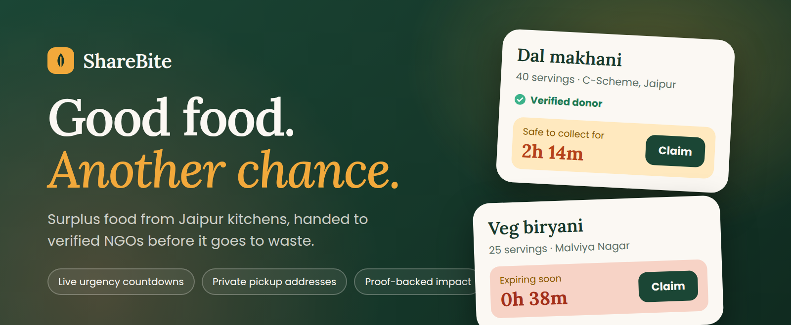
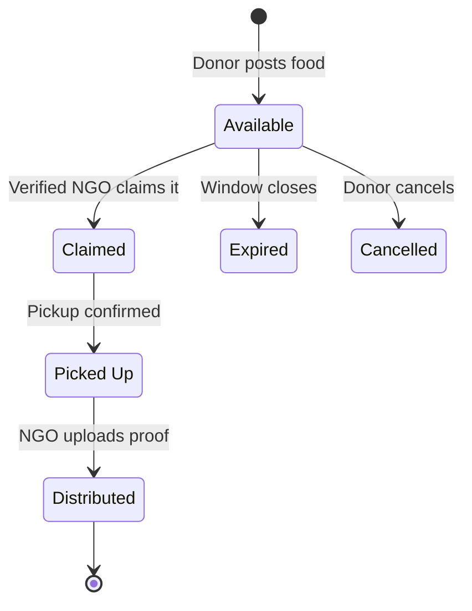
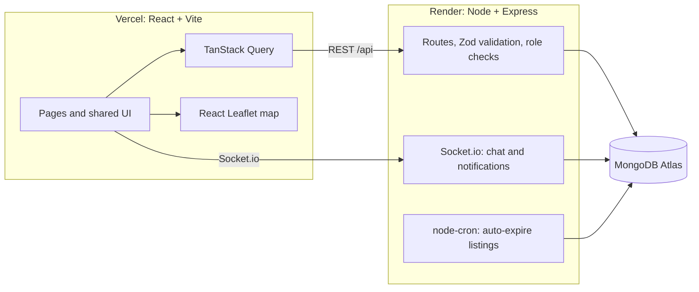

<p align="center">
  
</p>

<p align="center">
  <a href="https://sharebite-anurag.vercel.app"></a>
</p>

<p align="center">
  
  
  
  
  
  
  
</p>

<p align="center">
  <a href="#why-sharebite">Why</a> ·
  <a href="#what-you-can-do">Features</a> ·
  <a href="#the-donation-journey">Journey</a> ·
  <a href="#three-minute-demo">Demo</a> ·
  <a href="#architecture">Architecture</a> ·
  <a href="#quick-start">Quick start</a> ·
  <a href="#deploying-vercel--render">Deploy</a> ·
  <a href="#testing-and-verification">Testing</a>
</p>

---

## Why ShareBite

Every evening, kitchens across a city quietly throw away good food: a tray of dal makhani after a corporate lunch, biryani left over from a wedding, bread that did not sell. At the same time, community organisations are looking for meals. The food exists and so does the need. What is missing is trust, timing and a safe handoff between the two.

**ShareBite is a hyperlocal platform for Jaipur that connects food donors (restaurants, hotels, wedding venues, households and individuals) with verified NGOs before the food goes to waste.**

It is designed around three principles:

| Principle | What it means in the product |
|---|---|
| **Proof over promises** | Impact is counted only when an NGO uploads a distribution photo and the number of people fed. Leaderboards, badges and certificates use these verified meals, never the number of listings posted. |
| **Privacy by default** | A donor's exact pickup address stays hidden until an NGO's claim is confirmed. Chat automatically masks phone numbers and emails, so coordination stays on the platform. |
| **Trust through verification** | Only verified NGOs can claim food. Admins review submitted documents, handle reports and can ban or restore accounts. |

> ShareBite began as a hackathon build for **Utsav-e-Diwali (organised by Kalvium, 30 October 2026)** and is maintained as a full-stack portfolio project.

---

## What you can do

| Role | Capabilities |
|---|---|
| **Public visitor** | Browse the landing page with live impact numbers, the food discovery feed and map, the NGO directory, the impact leaderboard and public certificate pages. |
| **Donor** | Register or log in, then post a donation with photos, quantity, food type, allergens, preparation time, pickup window and a map location. Save a "usual surplus" template for one-tap reposting. Invite one specific NGO privately. Follow orders, respond to NGO meal requests, view impact and download certificates. |
| **NGO** | Discover and filter nearby food by urgency and distance. Claim available donations, coordinate through order chat, confirm pickup and upload distribution proof. Review donors, post and fulfil demand requests ("We need 200 meals for Sunday"), and track capacity and impact. |
| **Admin** | Review submitted verification documents, verify or reject accounts, ban or restore users, review reports, inspect all orders and view platform analytics. |
| **Everyone, live** | In-app notifications (bell inbox plus toasts) for nearby food, claims, messages, status changes and verification results. |

**Highlights**

- **Live urgency.** Every listing has a countdown that changes colour as the pickup deadline approaches.
- **"Safe until" estimate.** A planning estimate calculated from the food category and cooked time, with a warning when the pickup deadline runs past it.
- **Cards and map.** A discovery feed with filters, plus a Jaipur map with colour-coded markers.
- **Order chat with masking.** Phone numbers, emails and social handles are replaced with "[contact hidden – use platform chat]".
- **Certificates of Honor.** Downloadable PDFs with a unique certificate ID and a public verification page.
- **One-click Demo Mode.** Log in as a donor, NGO or admin without typing a password.
- **Light and dark themes**, fully designed and mobile-first.

<!--
SCREENSHOTS: uncomment this block after adding real images to docs/screenshots/
(run `node scripts/verify-browser.mjs --existing --offline-map` and copy the best
files from .cache/screenshots/ into docs/screenshots/).

## A look inside

| Landing | Food discovery (map) |
|---|---|
|  |  |

| Order timeline and chat | Leaderboard and certificate |
|---|---|
|  |  |

| Mobile | Dark mode |
|---|---|
|  |  |
-->

---

## The donation journey



1. **Post.** The donor lists the food, and ShareBite shows a live "safe until" countdown.
2. **Claim.** Only a verified NGO can claim, which locks the listing for them. The exact pickup address is then revealed to the confirmed participants only.
3. **Coordinate.** Donor and NGO talk in the order chat, with contact details masked automatically.
4. **Pick up.** The pickup is confirmed on the platform.
5. **Distribute.** The NGO uploads a photo and a people-fed count. These verified meals drive the impact cards, badges, rankings and certificates.
6. **Review.** Both sides can leave a rating after completion.

A background job runs every minute and expires listings whose pickup or safety window has closed, notifying the donor.

> **Food safety:** the "safe until" time is a planning estimate based on food category and preparation time, not a certification. Donors must confirm safe handling, and collection teams should decline food whose condition is uncertain.

---

## Three-minute demo

Use the **Demo Mode** buttons on the login page, or sign in with the accounts below. All three passwords are `Demo@1234`.

| Role | Email | Best place to begin |
|---|---|---|
| Donor | `donor@demo.com` | Share food, then view the dashboard |
| NGO | `ngo@demo.com` | Explore food, then claim a listing |
| Admin | `admin@demo.com` | Admin panel for verification and moderation |

| Time | Action | What to point out |
|---|---|---|
| 0:00–0:30 | Start on the landing page. Open **Explore food** and switch between cards and map. | Live impact, Jaipur listings, distance and pickup urgency. |
| 0:30–1:15 | In Demo Mode, log in as **Donor**. Open **Share food**, enter details, upload a photo, set the pickup address, accept the safety declaration and post. | The safety countdown. The exact address stays private until a claim. Saved templates speed up repeat donations. |
| 1:15–1:55 | Use **Switch role** to log in as **NGO**. Find the new listing, claim it and open the order chat. | The collection is reserved for one NGO. A phone number sent in chat is masked automatically. |
| 1:55–2:35 | Confirm pickup, then upload a distribution photo, a people-fed count and a short note. | The timeline reaches **Distributed**. The donor is notified and can see the proof. |
| 2:35–3:00 | Open **Leaderboard**, update the certificate and download its PDF. Switch back to Donor to see the completed order and impact dashboard. | Rankings use proof-backed meals. Each certificate has a public verification page. |

---

## Architecture



### Key engineering decisions

| Decision | Why it matters |
|---|---|
| **Impact is derived from distribution proof** | Rankings cannot be gamed by posting many listings. Only completed orders with a proof photo and a people-fed count are counted. |
| **Server-side authorization on every route** | Roles (donor, NGO, admin) are enforced in the API, not just hidden in the UI. Password hashes are never returned. |
| **Address privacy at the data layer** | Private listing addresses and protected uploads are returned only to authorised participants or admins. |
| **Contact masking in chat** | Phone numbers, emails and social handles are masked on the server before messages are stored and broadcast. |
| **Single order state machine** | Listing and order status changes go through explicit transitions (Available, Claimed, Picked Up, Distributed, Expired, Cancelled), so the UI, notifications and impact numbers stay consistent. |
| **Self-healing local setup** | With no `MONGO_URI`, the server starts an in-memory MongoDB and seeds it, so `npm install && npm run dev` works on any machine. Production deliberately refuses to start without a real database. |
| **Idempotent seeding** | An empty database is seeded once. Existing users are never cleared. |
| **JSON-only API errors** | Unknown `/api/*` routes return a JSON 404, so the client never receives an HTML error page where it expects data. |
| **One origin list for REST and Socket.io** | `CLIENT_URL` controls CORS for both, which avoids a common production failure where the API works but live updates do not. |

---

## Tech stack

| Layer | Technologies |
|---|---|
| **Frontend** | React 18, Vite, Tailwind CSS, Radix and shadcn-style components, React Router, TanStack React Query, Framer Motion, lucide-react, React Leaflet with OpenStreetMap, Recharts, jsPDF |
| **Backend** | Node.js, Express, Mongoose, JWT and bcrypt, Socket.io, node-cron, multer, Zod |
| **Database** | MongoDB (Atlas in production, in-memory for local development) |
| **Deployment** | Vercel (client), Render (API), MongoDB Atlas |
| **Tooling** | ESLint, Node test runner, Chrome/Edge-driven browser verification scripts |
| **Design** | Fraunces and Plus Jakarta Sans, warm paper, forest green and saffron palette, optional dark theme |

No paid third-party APIs and no map API key are required. The map uses OpenStreetMap tiles when reachable and a bundled Jaipur backdrop otherwise.

---

## Quick start

**Requirements:** Node.js 20.19+ (22 LTS recommended), npm 10+, and internet access for the first in-memory MongoDB download (about 70 MB, cached afterwards). No MongoDB account, API key or `.env` file is needed.

```bash
git clone https://github.com/avi4rag/ShareBite.git
cd ShareBite
npm install
npm run dev
```

Open **http://localhost:5173**. The API runs at http://localhost:4000, and `/api/health` reports whether it is ready and which database mode is active. Vite proxies local API, image and Socket.io requests to the server.

With no `MONGO_URI`, ShareBite starts an in-memory MongoDB and seeds the demo automatically. The server logs this mode clearly. Memory-mode data resets when the server stops.

### Demo data

The seed creates **26 donors, 15 NGOs (12 verified, 2 pending, 1 rejected), 68 listings and 36 completed orders**, plus reviews, chat histories, notifications, reports and meal requests. Organisation names, registration numbers and profiles are fictional. Jaipur neighbourhoods and coordinates are realistic, and seed food photos are bundled locally.

---

## Configuration

The app works without an `.env` file. To change settings, copy `.env.example` to `.env` in the repository root.

| Variable | Default | Purpose |
|---|---|---|
| `MONGO_URI` | empty | Persistent MongoDB connection. **Required in production.** In development, the server falls back to memory if it is missing or unreachable. |
| `JWT_SECRET` | generated on startup in development | Signing secret for login tokens. **Required when `NODE_ENV=production`.** |
| `PORT` | `4000` | Express API and Socket.io port. |
| `CLIENT_URL` | Vercel production domain plus local origins | Comma-separated allowed browser origins for the API and Socket.io. |
| `NODE_ENV` | development | Set to `production` on Render. Production requires MongoDB and `JWT_SECRET`. |
| `SEED_ON_START` | `true` | Seeds an empty database at startup and never clears existing users. Set `false` to disable. |
| `DEMO_MODE` | enabled outside production | Set `false` to disable one-click demo login. |
| `VITE_API_URL` | unset | Client API origin. Set to the Render origin on Vercel. When unset, the client uses relative `/api` through the Vite proxy or the Vercel rewrite. |
| `VITE_SOCKET_URL` | `VITE_API_URL` or current origin | Socket.io origin. Set to the Render origin on Vercel for direct realtime traffic. |

Keep `.env` private. The example file contains no credentials, and `.gitignore` excludes `.env`, uploads, build output and dependencies. For local development, leave the `VITE_` values unset so Vite uses its proxy. Vite reads client variables from `client/.env.local` or from the Vercel dashboard, not from the root `.env`.

Uploaded files are stored locally in `server/uploads/`. You can also run `npm run seed` to populate an empty configured database. The seed command skips a database that already has users.

---

## Deploying: Vercel + Render

The frontend runs on **Vercel** from `client/`, and the API runs on **Render** from `server/`.

### 1. Render (backend)

| Setting | Value |
|---|---|
| Branch | `main` |
| Root Directory | `server` |
| Build Command | `npm install` |
| Start Command | `node src/index.js` |

Environment variables:

```env
NODE_ENV=production
MONGO_URI=<your MongoDB Atlas connection string>
JWT_SECRET=<a long random secret you generate>
CLIENT_URL=https://sharebite-anurag.vercel.app,http://localhost:5173,http://127.0.0.1:5173
SEED_ON_START=true
DEMO_MODE=true
```

- Render provides `PORT`, and the server binds to `0.0.0.0` on that port.
- In MongoDB Atlas, add `0.0.0.0/0` under **Network Access** so Render can connect, then redeploy.
- Confirm that the root URL and `/api/health` return JSON. An empty Atlas database receives the Jaipur demo seed once. Restarts preserve existing users and orders.
- Switch `DEMO_MODE` to `false` after demonstrations if you do not want public one-click accounts.
- Production intentionally fails with a clear message if MongoDB is missing or unreachable, instead of silently running an in-memory database.

### 2. Vercel (frontend)

| Setting | Value |
|---|---|
| Branch | `main` |
| Root Directory | `client` |
| Framework Preset | Vite |
| Build Command | `npm run build` |
| Output Directory | `dist` |

Environment variables (Production, and Preview if you use preview deployments):

```env
VITE_API_URL=https://sharebite-3zgy.onrender.com
VITE_SOCKET_URL=https://sharebite-3zgy.onrender.com
```

Use the origin exactly as shown, with **no `/api` suffix and no trailing slash**. Vite embeds these values at build time, so **redeploy Vercel after editing either one**.

If `VITE_API_URL` is omitted, `client/vercel.json` proxies `/api`, `/uploads` and `/seed-assets` to Render. That file also routes refreshed pages such as `/login` and `/discover` back to the React app. Direct Render calls are the recommended configuration.

### Production notes

- Render's free service sleeps when idle, so the first request after a quiet period can be slow. Open `/api/health` a few minutes before presenting.
- Render's free filesystem is ephemeral. MongoDB records persist in Atlas, but photos uploaded to `server/uploads/` do not survive a redeploy or restart. Bundled seed photos remain available. Use object storage (for example S3 or Cloudinary) for real uploads.
- Vercel and Render are different origins, so `CLIENT_URL` must include the exact Vercel domain for both API calls and Socket.io.

---

## Testing and verification

Run these from the repository root.

| Command | What it does |
|---|---|
| `npm run dev` | Starts the API and the Vite client together. |
| `npm run seed` | Seeds an empty configured MongoDB, or validates a temporary memory seed. |
| `npm run lint` | Runs ESLint across both workspaces. |
| `npm run build` | Builds the client and checks the server entry point. |
| `npm run test` | Runs the API, privacy, seed, startup and lifecycle tests in an isolated in-memory database, ignoring any configured `MONGO_URI`. |
| `node scripts/verify-production.mjs` | Starts the real production server against a temporary MongoDB and checks JSON routes, seeding, demo logins, CORS and JSON 404s. |
| `node scripts/verify-browser.mjs --existing --offline-map` | Checks key screens at desktop and mobile widths and saves screenshots under `.cache/screenshots/`. |
| `node scripts/verify-core-loop.mjs` | Drives the full donor-to-NGO journey in Chrome or Edge: post food, claim it, send a masked chat message, complete pickup and proof, download a certificate, check notifications and confirm the donor sees the result. It fails on browser console errors. |

The two browser scripts expect `npm run dev` to be running already and need Chrome or Edge installed locally.

---

## API overview

All application endpoints live under `/api`.

| Endpoint group | Purpose |
|---|---|
| `/api/auth`, `/api/users` | Login, registration, demo login, session and profiles. |
| `/api/listings`, `/api/orders`, `/api/uploads` | Food listings, claims, status changes, proof, reviews and protected files. |
| `/api/chat`, `/api/notifications` | Participant chat, message masking and inbox updates. |
| `/api/ngos`, `/api/demands`, `/api/reports` | NGO directory, meal requests and community reports. |
| `/api/stats`, `/api/leaderboard`, `/api/certificates` | Verified impact, rankings and recognition. |
| `/api/admin` | Account verification, moderation, reports and order oversight. |
| `/api/health` | Readiness and active database mode. |

---

## Project structure

```text
ShareBite/
├── client/              React app: pages, shared UI, styles, local map art
├── server/              Express API, Mongoose models, seed data, local food photos
│   ├── seed-assets/     Bundled demo images
│   └── uploads/         Runtime uploads (ignored by Git)
├── scripts/             Browser walkthroughs and verification helpers
├── docs/                Design brief, architecture, PR notes and README assets
├── .env.example         Optional environment settings
└── package.json         Root commands for both workspaces
```

For design decisions, see the [design brief](docs/design-brief.md). For data, privacy and runtime contracts, see [architecture](docs/architecture.md). Review notes from each feature branch are in [`docs/pull-requests/`](docs/pull-requests/).

---

## Security and privacy

- Inputs are validated with Zod, and roles are checked server-side on every protected route.
- Passwords are hashed with bcrypt, and password hashes are never returned by the API.
- Login uses signed JWTs. In production, `JWT_SECRET` is mandatory and the server will not start without it.
- Exact pickup addresses and protected uploads are visible only to confirmed participants and admins.
- Chat masks direct contact details to keep coordination on the platform.
- Demo accounts and fictional seed data are for demonstration only. Set `DEMO_MODE=false` for a real deployment.

---

## Known limitations and roadmap

ShareBite is a working product demo, not a production service. Being clear about this is deliberate.

**Current limitations**

- NGO and donor verification is an admin review of submitted documents. It is not connected to a government registry.
- The "safe until" time is an estimate, not a food-safety certification.
- Uploaded photos are stored on local disk, so they are not durable on hosts with an ephemeral filesystem.
- Notifications are in-app only. There is no push, SMS or WhatsApp delivery yet.

**Roadmap**

- Persistent object storage for uploads.
- Push, email and WhatsApp notifications.
- A volunteer pickup network for NGOs without vehicles.
- Recurring and scheduled bulk donations for events and weddings.
- Hindi and regional-language support.
- Registry-backed NGO verification.

---

## Troubleshooting

<details>
<summary><b>First start takes a long time</b></summary>

The in-memory database downloads its MongoDB binary on first use (about 70 MB). Check your internet connection and let it finish. Alternatively, set a reachable `MONGO_URI`.
</details>

<details>
<summary><b>Port 4000 or 5173 is busy</b></summary>

Stop the other ShareBite process before starting a second `npm run dev`. The API prints a specific port-collision message.
</details>

<details>
<summary><b>A donation disappeared after restart</b></summary>

Memory mode is temporary. Set `MONGO_URI` for persistent data.
</details>

<details>
<summary><b>Map tiles do not load</b></summary>

The local Jaipur backdrop still shows listing markers. No map service account is needed.
</details>

<details>
<summary><b>Browser verification scripts cannot launch</b></summary>

Install Chrome or Edge locally. The application itself works in any modern browser.
</details>

<details>
<summary><b>Live feed says the API is unavailable</b></summary>

Check that Render's `/api/health` returns JSON, then redeploy Vercel with `VITE_API_URL` set to the Render origin. The browser console logs the URL and status whenever the API returns non-JSON. Also confirm that `CLIENT_URL` on Render includes the exact Vercel domain.
</details>

<details>
<summary><b>Render shows "Cannot GET /"</b></summary>

The server is running, but that route does not exist on the deployed commit. Check that Render deploys the `main` branch and that `main` contains the latest merged work. Then open `/api/health`.
</details>

---

## How it was built

ShareBite was planned and directed by me: the product idea, the feature set, the privacy and trust model, the data model and the design direction. The implementation was developed with AI coding assistants (OpenAI Codex and ChatGPT) working under written specifications, in a branch-and-pull-request workflow. Each feature lives on its own branch with small Conventional Commits, and review notes are saved in [`docs/pull-requests/`](docs/pull-requests/).

## Contributing

1. Branch from the latest `main` using `feat/`, `fix/`, `chore/` or `docs/` prefixes.
2. Commit in small steps with [Conventional Commits](https://www.conventionalcommits.org/) such as `feat(listings): add geo-nearby query`.
3. Run `npm run lint`, `npm run build` and `npm run test` before opening a pull request.
4. Open a PR into `main` with a summary, a list of changes, how to test it and screenshots for UI changes.

## Author

Built by **Anurag** ([@avi4rag](https://github.com/avi4rag)).

If ShareBite is useful to you, a star on the repository is always appreciated.